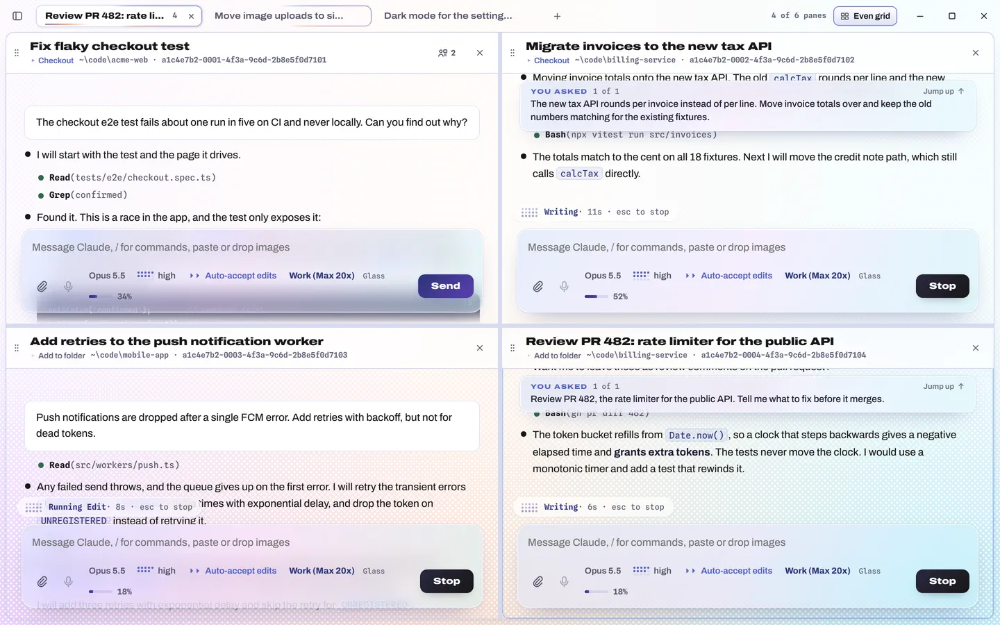
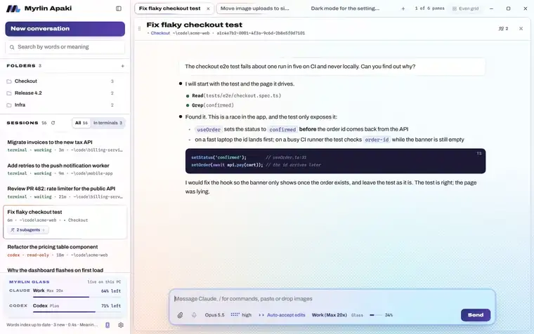
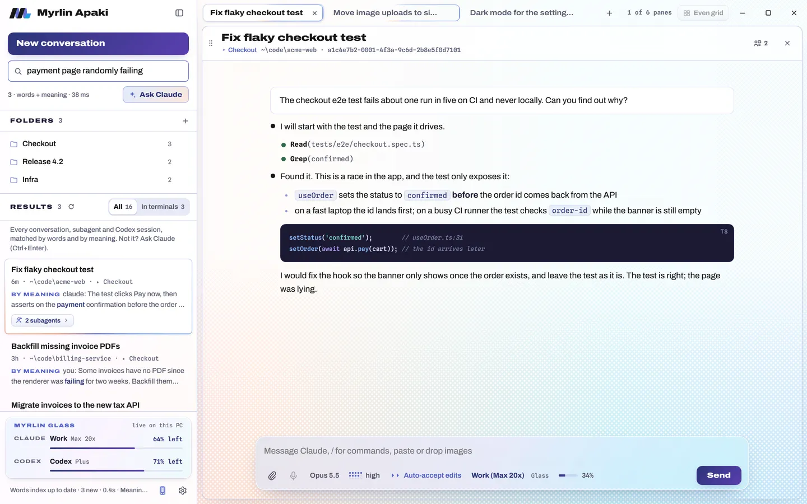
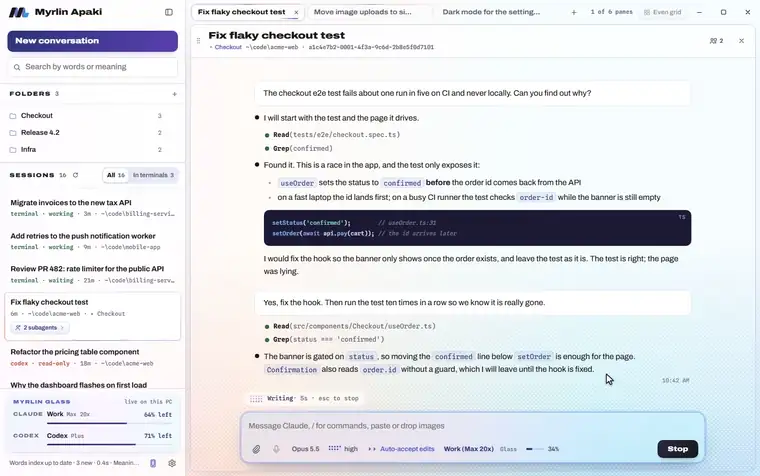
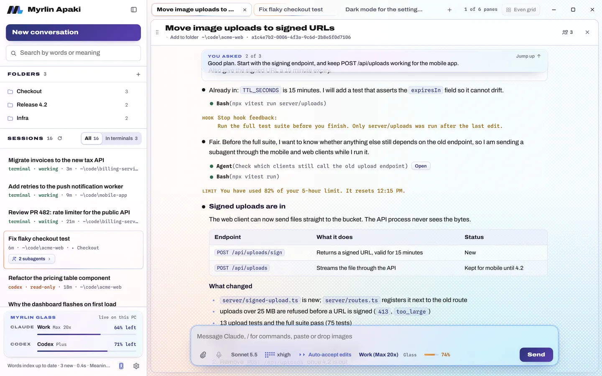
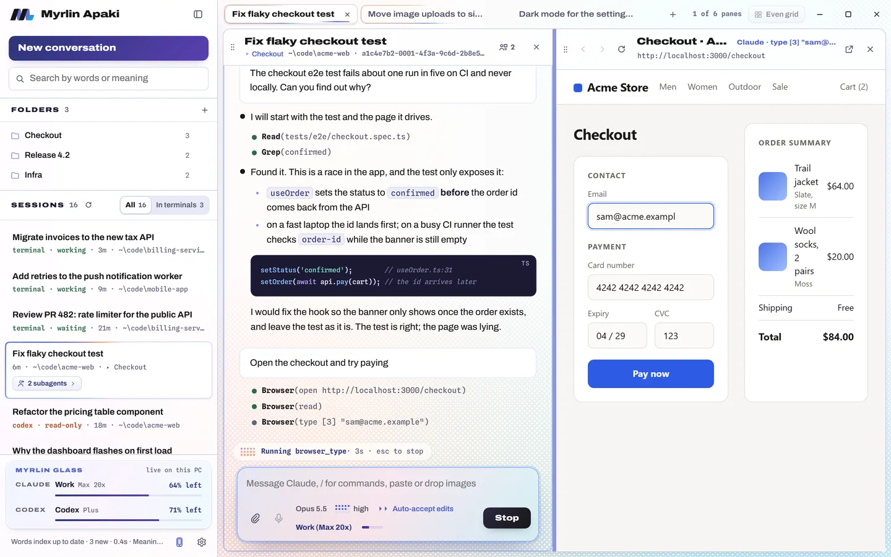
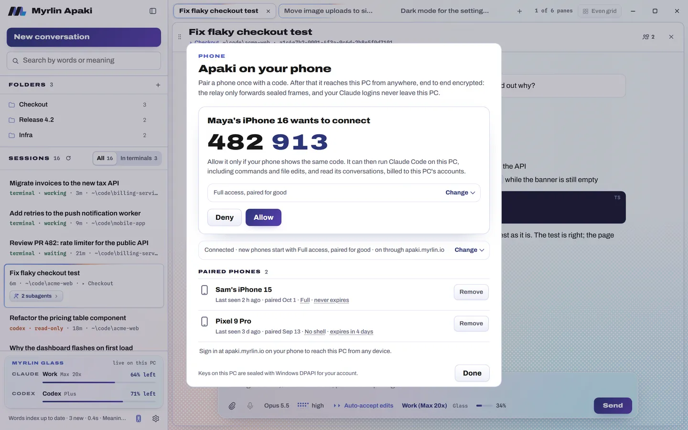
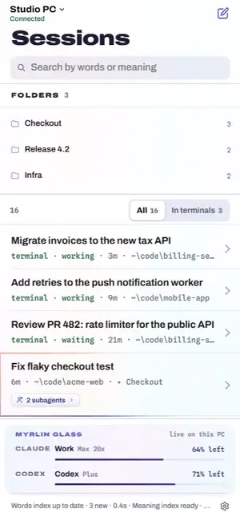

<!--
  Myrlin Apaki's README, the front page of github.com/therealarthur/apaki. Written 2026-10-12 by Claude Code
  (Opus 5.5) for Arthur, moved to the repository root when the repository went public the same day.
  Images: apaki/docs/media (made by apaki/demo/site-media.mjs and brand-images.mjs from the demo harness, invented data).
  The terminal companion latch, which this repository started as, is described in LATCH.md.
-->

<p align="center">
  <picture>
    <source media="(prefers-color-scheme: dark)" srcset="apaki/docs/media/wordmark-dark.png">
    
  </picture>
</p>

<p align="center"><b>Every Claude Code session on your PC, in one window.</b><br>
Free, open source, and yours to run.</p>

<p align="center">
  <a href="https://apaki.myrlin.io">Website</a> ·
  <a href="https://github.com/therealarthur/apaki/releases">Download for Windows</a> ·
  <a href="https://apaki.myrlin.io/app/">Web app</a> ·
  <a href="apaki/docs/self-hosting.md">Self-host</a> ·
  <a href="apaki/docs/security.md">Security</a> ·
  <a href="apaki/docs/faq.md">FAQ</a>
</p>

<picture>
  <source media="(prefers-color-scheme: dark)" srcset="apaki/docs/media/hero-dark.webp">
  
</picture>

Apaki is a desktop app for Claude Code on Windows. It lists every Claude Code session on your PC, including the ones running in terminals, and opens them in tabs of up to six panes. Myrlin Glass is built in, so you can see how much each Claude and Codex account has left and switch with a click. Claude gets a browser pane of its own. And your phone can pick up the same sessions through an end to end encrypted relay, which you can run yourself.

Underneath, it is the real Claude Code: Apaki drives it through Anthropic's Agent SDK with Claude Code's own system prompt and every settings source, so your `CLAUDE.md`, skills, plugins, hooks, MCP servers and slash commands behave as they do in a terminal. Sessions stay in Claude Code's own files. Open one in Apaki, continue it in a terminal with `/resume`, and come back.

Every picture on this page is the real app running on made-up demo data ([how it is recorded](apaki/demo/README.md)).

## Myrlin Glass, built in

<picture>
  <source media="(prefers-color-scheme: dark)" srcset="apaki/docs/media/glass-swap-dark.webp">
  
</picture>

The card at the bottom of the sidebar shows the live Claude and Codex accounts, each with what it has left. Click to switch subscriptions, or move a conversation to an Anthropic API key when a limit is close. The conversation keeps its context: it continues in the same Claude Code session file on the key, so nothing forks, and you can move it back. When Glass switches by itself, open conversations follow it before their next message.

Billing is per conversation, so one pane can run on your subscription while another runs on a key. For API-key sessions Apaki can also keep the prompt cache warm while you are away, with a daily cap. Measured on Opus 5.5, 68 minutes after the first turn: the next turn of a kept-warm conversation cost $0.125 and read 62,518 tokens from cache; the same conversation left alone had to write 59,314 tokens again and cost $0.478.

## Every session on the PC, found for you

<picture>
  <source media="(prefers-color-scheme: dark)" srcset="apaki/docs/media/sessions-dark.webp">
  
</picture>

Apaki reads Claude Code's transcripts, so the list has everything: sessions you started in a terminal, headless runs (`claude -p`), workers. A session open in a terminal window shows up within about two seconds, marked working or waiting. Search finds sessions by words and by meaning, with a local index and a local embedding model; nothing is uploaded. When you cannot remember which session it was, Ask Claude reads the best matches and says why each one fits.

Codex sessions are listed and searchable today, read-only. Opening them in panes is coming ([CODEX.md](apaki/remote/CODEX.md)).

## Tabs, panes, and a Claude that listens while it works

<picture>
  <source media="(prefers-color-scheme: dark)" srcset="apaki/docs/media/steer-dark.webp">
  
</picture>

- Up to six panes per tab. Shift-click a session to open it beside the others, or drag it onto a pane's edge.
- Each pane has its own model, effort and permission mode, with questions and plan approvals as real dialogs.
- Enter queues your next message while Claude works; Ctrl+Enter steers it into the running turn.
- What Claude Code reports shows in the conversation: hook output, API retries, usage warnings, compaction.
- A Tasks button lists each conversation's subagents and background shells and opens any of them live.
- Close the window and the sessions keep running. The workspace (tabs, splits, drafts, queued messages, scroll positions) is saved as you work and comes back exactly as it was after a crash.

<picture>
  <source media="(prefers-color-scheme: dark)" srcset="apaki/docs/media/history-dark.webp">
  
</picture>

## A browser pane that Claude drives

<picture>
  <source media="(prefers-color-scheme: dark)" srcset="apaki/docs/media/browser-dark.webp">
  
</picture>

Ask Claude to try a page and it opens beside the conversation instead of in another Chrome tab. Claude reads it as an outline with numbered links, buttons and fields, then clicks, types, goes back and takes screenshots, and you watch the same page. Pages in the pane have no access to the app or your sessions. When Claude or a tool tries to open your system browser (`vite --open`, Python's `webbrowser`), the page opens in Apaki. Documents, SVG, images and PDFs that Claude wants to show you open in a viewer with every revision kept.

## Your sessions on your phone

<table>
  <tr>
    <td width="68%">
      <picture>
        <source media="(prefers-color-scheme: dark)" srcset="apaki/docs/media/phone-pair-dark.webp">
        
      </picture>
    </td>
    <td width="32%">
      <picture>
        <source media="(prefers-color-scheme: dark)" srcset="apaki/docs/media/phone-loop-dark.webp">
        
      </picture>
    </td>
  </tr>
</table>

Open the Phone sheet and scan its code with the Apaki iPhone app or your phone's camera. Both screens show the same six digits; you allow the phone on the PC, and it stays paired until you remove it. The phone gets the session list, the conversations and the same Claude Code that runs on the PC.

- Free, with no account. End to end encrypted between the phone and the PC.
- You decide on the PC what each phone may do: Full, No shell, or Chat only. The PC enforces it. Billing, account switching and pairing stay on the PC.
- Optional Apaki account: a passkey, with no email and no password. Sign in on another phone and your PCs are there, once you allow it on the PC.
- Coming with Apaki Cloud: sign in from any browser with your phone's passkey, with nothing saved in that browser and an automatic sign-out after 30 minutes without input ([CLOUD.md](apaki/remote/CLOUD.md)).

## What the relay can and cannot see

The relay forwards sealed frames between your phone and your PC. It cannot read your prompts, replies, files or session list, cannot change them without the connection failing, and cannot pair a phone or connect to your PC (the PC only ever makes one outgoing connection). Your Claude and Codex logins never leave the PC. The relay does see IP addresses, connection times and how much data moves.

The web version of the phone client is code served by apaki.myrlin.io, so your PC checks it: before it shows a pairing code it builds that page from its own code and compares every file with what the site serves, and it checks again every hour while phone access is on. The iPhone app carries its own copy of the code. If you would rather not trust our site, run your own relay.

[Security in plain words](apaki/docs/security.md) · [The full security review](apaki/SECURITY.md) · [The protocol](apaki/remote/PROTOCOL.md)

## Coming next

| | |
|-|-|
| Codex in panes | Codex threads next to Claude's, with Codex's own pickers, questions and approvals. [CODEX.md](apaki/remote/CODEX.md) |
| Worktrees | Start a conversation in a new git worktree; see work by repository and branch; view changes, commit, push and open a pull request from the pane. [WORKTREES.md](apaki/remote/WORKTREES.md) |
| Apaki Cloud | Any-browser sign-in that saves nothing, a Cloud button on the desktop listing your machines, and phone push when Claude asks or finishes. A paid option on our hosted relay; a relay you run gets every feature. [CLOUD.md](apaki/remote/CLOUD.md) |

## Install

- **Windows:** [the releases page](https://github.com/therealarthur/apaki/releases), or build the package from source ([apaki/docs/contributing.md](apaki/docs/contributing.md)). The package carries Claude Code, Node and Myrlin Glass; sign in with Claude Code's own login (`claude auth login`, offered at the end of the install) or use an Anthropic API key. WebView2 is part of Windows 11 and is installed if it is missing.
- **iPhone:** in TestFlight, by invite for now. The App Store comes later.
- **Any phone browser:** [apaki.myrlin.io/app](https://apaki.myrlin.io/app/), then pair it from the Phone sheet on your PC.

## Run your own relay

The relay is one Cloudflare Worker, and the free plan is enough for a few people. [docs/self-hosting.md](apaki/docs/self-hosting.md) walks through it; the reference is [relay/README.md](relay/README.md).

```
cd relay
npm install
node ../apaki/scripts/build-web.mjs --release --relay wss://relay.example.com
npx wrangler deploy --env=""
```

Then start Apaki with `APAKI_RELAY_URL=wss://relay.example.com` and `APAKI_WEB_URL=https://relay.example.com/`.

## Build from source and contribute

See [docs/contributing.md](apaki/docs/contributing.md): how the repository is laid out, how to run the tests, how to package the Windows app, and how the recordings above are made.

## More reading

- [FEATURES.md](FEATURES.md): everything that is built, in more detail
- [LATCH.md](LATCH.md): latch, the terminal companion this repository started as (continue a Claude Code session on an API key)
- [docs/faq.md](apaki/docs/faq.md): questions people ask
- [SECURITY.md](apaki/SECURITY.md), [remote/PROTOCOL.md](apaki/remote/PROTOCOL.md), [remote/ACCOUNTS.md](apaki/remote/ACCOUNTS.md), [remote/ENROLL.md](apaki/remote/ENROLL.md): the security review and the protocols
- [mobile/README.md](apaki/mobile/README.md): the iPhone and Android apps
- [demo/README.md](apaki/demo/README.md): the demo harness that records the real UI on invented data

## License

Everything in this repository is under the [Apache License 2.0](LICENSE), except the relay and the account service in `relay/`, which are under the [GNU Affero General Public License v3.0](relay/LICENSE). In short: use, change and ship the app freely; if you run a changed copy of the relay as a service for others, publish your changes to it. (Arthur, 2026-10-12, as the market research in [apaki/docs/research/2026-10-11-market.md](apaki/docs/research/2026-10-11-market.md) suggested.)

---

Apaki is a Myrlin Labs project. It is independent and not affiliated with or endorsed by Anthropic or OpenAI. Claude and Claude Code are trademarks of Anthropic.
